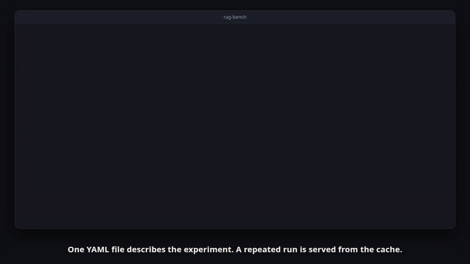
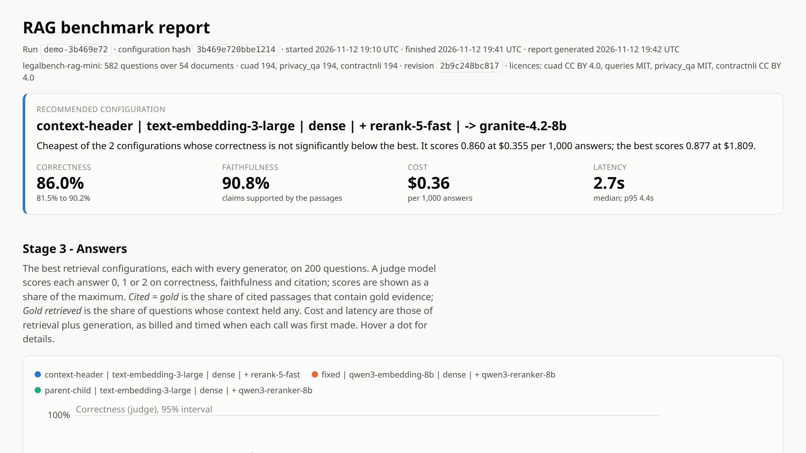
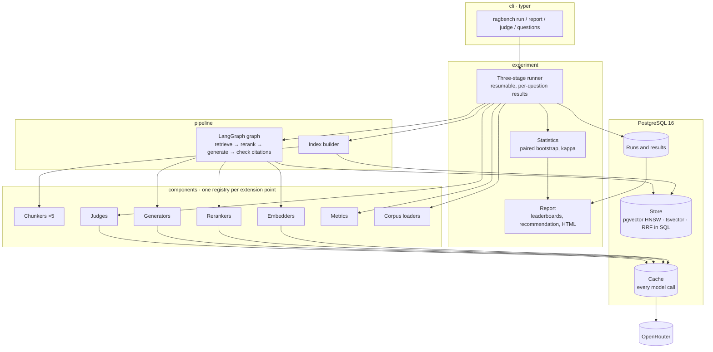

# rag-bench

**Find out which RAG setup works best on your own documents, and what it costs, before you build on it.**
A reproducible benchmark of chunking × embedding × search mode × reranker × generator that runs on
PostgreSQL and small open-weight models, for teams who need evidence instead of defaults.

[](https://github.com/joaopaulopresa/rag-bench/actions/workflows/ci.yml)
[](LICENSE)




## What it does

- **Tells you which configuration to ship.** One command compares chunking strategies, embedding
  models, search modes, rerankers and generators on the same questions, and the report ends with one
  recommendation and the reason for it.
- **Puts a price and a latency next to every score.** Cost is what the provider billed, per call, so
  "2 points better" is always shown against "four times the price".
- **Separates real differences from noise.** Every comparison is paired on the same questions, with
  bootstrap intervals; a gain whose interval contains zero is reported as no significant difference.
- **Costs nothing to repeat.** Every model call is cached in PostgreSQL. An interrupted run continues
  where it stopped, and a finished run reproduces its tables for free.
- **Works on your documents.** Point it at a folder; it drafts questions with their evidence spans for
  a person to review, and only reviewed questions count as gold.

## Quick start

Requirements: Docker, [uv](https://docs.astral.sh/uv/). No API key is needed for the first run.

```bash
git clone https://github.com/joaopaulopresa/rag-bench && cd rag-bench
docker compose up -d db                      # PostgreSQL 16 + pgvector on port 54329
uv sync

uv run ragbench run configs/offline.yaml     # all three stages, offline stand-in models, seconds
uv run ragbench report offline-1d8c38ff      # the run id is printed by the command above
# open reports/offline-1d8c38ff/index.html
```

With real models through [OpenRouter](https://openrouter.ai):

```bash
cp .env.example .env                         # then set OPENROUTER_API_KEY
uv run ragbench config configs/demo.yaml     # validate and print the resolved config; free
uv run ragbench run configs/demo.yaml --limit 30   # development run on 30 questions (about $1)
uv run ragbench run configs/demo.yaml              # the full experiment below
```

## Demo

[](docs/media/demo.mp4)

The video and the animation above are generated, not recorded by hand:
`uv run --group demo python e2e/demo/record.py` runs the real commands, replays their real output
and films the real report with Playwright.

## Results of the demo experiment

Run `demo-3b469e72` (configuration hash `3b469e720bbe1214`, 12 November 2026), LegalBench-RAG mini
without MAUD: **582 questions over 54 documents** (194 each from PrivacyQA, ContractNLI and CUAD),
dataset revision `2b9c248b`. Every number below comes from that run and is regenerated, at no cost,
by:

```bash
uv run ragbench run configs/demo.yaml     # replays the run from the cache
uv run ragbench report demo-3b469e72      # writes reports/demo-3b469e72/index.html and CSVs
```

The whole run made 24,570 evaluations and cost **$4.19** in model calls, plus about $0.26 to embed the
indexes once. A repeat takes about three seconds and costs nothing.

**Recommendation of the run:** context-header chunks, `text-embedding-3-large`, dense search,
`rerank-5-fast`, answered by `granite-4.2-8b`: correctness 86.0% at **$0.36 per 1,000 answers**. The
highest-scoring setup (same retrieval, `qwen3.8-27b`) reaches 87.8% at $1.81; the 1.8-point gap is
inside the noise (paired 95% interval -5.8 to +2.2), so the report picks the one that costs a fifth.

### Stage 1: retrieval without a reranker (35 configurations, 582 questions)

`char_recall@5` is the share of gold evidence characters found in the top five passages. The table
shows the best configuration of each chunker; the full grid is in the report.

| Chunker | Best embedder and mode | char_recall@5 (95% interval) | char_precision@5 | nDCG@10 | Chunks |
|---|---|---|---|---|---|
| Context header | `text-embedding-3-large`, dense | 82.5% (79.7% to 85.4%) | 5.0% | 69.7% | 814 |
| Parent-child | `text-embedding-3-large`, dense | 78.9% (75.7% to 81.9%) | 2.7% | 66.9% | 2,675 |
| Fixed, 512 tokens | `qwen3-embedding-8b`, dense | 69.8% (66.5% to 73.3%) | 4.2% | 57.6% | 753 |
| Recursive | `text-embedding-3-large`, dense | 66.9% (63.1% to 70.4%) | 4.4% | 56.8% | 814 |
| Semantic | `text-embedding-3-large`, dense | 60.6% (56.9% to 64.3%) | 5.2% | 49.9% | 1,153 |

- **Telling the chunk where it comes from matters most.** Prefixing each chunk with its document
  title and section path lifts the best `char_recall@5` from 66.9% (same chunks, no header) to
  82.5%. The questions name the contract they are about, and a chunk from the middle of a
  contract does not.
- **Dense search beat hybrid search here**: mean `char_recall@5` over all chunkers and embedders is
  68.3% dense, 56.5% hybrid, 37.1% lexical. The lexical side is PostgreSQL `ts_rank`, which has no
  inverse document frequency; see the limits below before generalising.
- **Embedders:** best configuration per model is 82.5% (`text-embedding-3-large`),
  78.4% (`qwen3-embedding-8b`) and 74.1% (`bge-m3`), all at 1,024 dimensions.

### Stage 2: reranking (best configuration of each of the 3 best chunkers, 200 questions)

| Configuration | char_recall@5 | Without reranker | Gain (paired 95% interval) | $ per 1,000 queries | Median latency |
|---|---|---|---|---|---|
| context-header · text-embedding-3-large · dense · + rerank-5-fast | 91.1% | 80.4% | +10.7 pt (+6.0 to +15.4) | $0.21 | 1.4s |
| context-header · text-embedding-3-large · dense · + qwen3-reranker-8b | 90.1% | 80.4% | +9.7 pt (+5.2 to +14.3) | $2.23 | 1.7s |
| parent-child · text-embedding-3-large · dense · + qwen3-reranker-8b | 88.3% | 75.9% | +12.4 pt (+7.6 to +17.6) | $3.84 | 2.3s |
| parent-child · text-embedding-3-large · dense · + rerank-5-fast | 87.1% | 75.9% | +11.2 pt (+6.2 to +16.2) | $0.37 | 1.5s |
| fixed · qwen3-embedding-8b · dense · + qwen3-reranker-8b | 76.4% | 65.7% | +10.8 pt (+5.6 to +16.0) | $2.39 | 1.8s |
| fixed · qwen3-embedding-8b · dense · + rerank-5-fast | 72.8% | 65.7% | +7.1 pt (+1.7 to +12.5) | $0.22 | 1.4s |

Every reranker gain is significant (no interval contains zero). The two rerankers are not
distinguishable from each other on 200 questions, but their price is: through OpenRouter the Qwen
reranker cost about ten times as much per query as Cohere's.

### Stage 3: answers (3 retrieval configurations × 5 generators, 200 questions)

Scores are from the judge model `deepseek-v4.1-flash-1017` on a 0 to 2 rubric, shown as a share of
the maximum. **They have not been validated against human labels yet** (see the limits below). The
table shows each generator on the best retrieval configuration; all 15 rows are in the report.

| Generator | Correctness (95% interval) | Gap to best (paired) | Faithfulness | Citation | $ per 1,000 answers | Latency p50 / p95 |
|---|---|---|---|---|---|---|
| `qwen3.8-27b` | 87.8% (83.5% to 91.8%) | best | 96.5% | 97.8% | $1.81 | 2.4s / 5.6s |
| `granite-4.2-8b` | 86.0% (81.5% to 90.2%) | -1.8 pt (-5.8 to +2.2) | 90.8% | 89.2% | $0.36 | 2.7s / 4.4s |
| `gemma-4-31b-it` | 82.5% (77.5% to 87.2%) | -5.2 pt (-10.0 to -1.0) | 96.0% | 99.2% | $0.83 | 2.2s / 3.1s |
| `gemma-4-26b-a4b-it` | 79.8% (74.5% to 85.0%) | -8.0 pt (-12.5 to -3.8) | 95.5% | 99.0% | $0.41 | 2.3s / 3.2s |
| `mistral-small-2603` | 63.0% (56.8% to 69.0%) | -24.8 pt (-31.0 to -19.2) | 86.8% | 88.8% | $0.60 | 2.1s / 2.8s |

The generator matters most here (63% to 88% on the same passages), but retrieval still moves the
best generator by 5 to 8 points. All five generators on each of the three retrieval configurations:

| Retrieval configuration | Gold evidence in context | Best correctness | Mean prompt tokens | $ per 1,000 answers (cheapest to dearest) |
|---|---|---|---|---|
| context-header · text-embedding-3-large · dense · + rerank-5-fast | 94.5% | 87.8% (`qwen3.8-27b`) | 2,478 | $0.36 to $1.81 |
| fixed · qwen3-embedding-8b · dense · + qwen3-reranker-8b | 83.5% | 82.2% (`qwen3.8-27b`) | 2,715 | $2.55 to $3.78 |
| parent-child · text-embedding-3-large · dense · + qwen3-reranker-8b | 90.0% | 80.0% (`qwen3.8-27b`) | 4,575 | $4.09 to $5.48 |

Parent-child retrieval returns whole sections, so its prompts are almost twice as long without the
answers being better on this corpus. Most of the cost in the last two rows is the Qwen reranker
($2.23 to $3.84 per 1,000 queries), not the generator.

## Use it as a library

`ragbench` is a typed package first and a command line second; anything the CLI does is available
from Python. Install a tagged release:

```bash
pip install "git+https://github.com/joaopaulopresa/rag-bench@v0.1.0"
```

```python
import asyncio, os
from ragbench import (
    ComponentConfig,
    PipelineConfig,
    build_pipeline,
    evaluate_retrieval,
    load_corpus,
    open_session,
)

CONFIG = PipelineConfig.model_validate(
    {
        "chunker": {"name": "context_header", "params": {"max_tokens": 512}},
        "embedder": {"name": "openrouter", "params": {"model": "baai/bge-m3", "dimensions": 1024}},
        "search_mode": "dense",
        "reranker": {"name": "openrouter", "params": {"model": "cohere/rerank-5-fast"}},
        "generator": {"name": "openrouter", "params": {"model": "ibm-granite/granite-4.2-8b"}},
    }
)


async def main() -> None:
    async with open_session(os.environ["RAGBENCH_DATABASE__URL"], env=os.environ) as session:
        corpus = load_corpus(
            ComponentConfig(name="folder", params={"path": "docs/"}), session.resources
        )
        pipeline = build_pipeline(
            CONFIG, resources=session.resources, store=session.store, collection="docs"
        )
        await pipeline.index(corpus.documents)

        answer = await pipeline.answer("What is the notice period?")
        print(answer.text, answer.citations, f"${answer.usage.cost_usd:.5f}")

        evaluation = await evaluate_retrieval(
            pipeline, corpus.questions
        )  # needs reviewed questions
        print(evaluation.means())


asyncio.run(main())
```

Every component sits behind a small protocol and is chosen by name. Adding one is a class and a
decorator, with no change to the package ([examples/04_custom_chunker.py](examples/04_custom_chunker.py)):

```python
from ragbench import Chunk, Document, Span, register_chunker


@register_chunker("paragraph")
class ParagraphChunker:
    def __init__(self, resources: object = None, min_chars: int = 1) -> None: ...
    async def chunk(self, document: Document) -> list[Chunk]: ...
```

A separate package can publish its implementations through entry points (`ragbench.chunkers`,
`ragbench.embedders`, `ragbench.rerankers`, `ragbench.generators`, `ragbench.judges`,
`ragbench.metrics`, `ragbench.loaders`, `ragbench.stores`, `ragbench.caches`), after which an
experiment file can name them like the built-in ones. `uv run ragbench components` lists what is
registered.

### Bring your own documents

```bash
uv run ragbench questions generate my-docs/ --count 40   # writes my-docs/questions.draft.json
# review each question, set "reviewed": true, save as my-docs/questions.json
uv run ragbench run my-experiment.yaml                   # corpus: {name: folder, params: {path: my-docs}}
```

## Architecture



- **Layers import downwards only:** `cli` → `experiment` → `pipeline` → `components` → `core`. `core`
  holds the protocols, the typed configuration and the registries, and performs no I/O.
- **Three small stages instead of one full grid.** Stage 1 tries every chunker × embedder × search
  mode with no reranker (only embeddings are paid). Stage 2 adds rerankers to the winners. Stage 3
  adds generators and a judge to the winners of that. Each stage keeps only what is worth paying for
  in the next.
- **The pipeline under test is a LangGraph graph**; chunking, search, metrics, statistics and the
  runner are plain Python, so no framework hides or slows down what is measured.
- **Search is one SQL statement** in all three modes. Hybrid search fuses the dense ranking
  (pgvector, cosine, HNSW) and the lexical ranking (`tsvector`) with reciprocal rank fusion inside
  the database.
- **An experiment is one YAML file**, validated at load time into a typed tree. Its hash names the
  run, and the fully resolved configuration is stored with the results.

## Tech stack

Python 3.11+ · PostgreSQL 16 with pgvector · psycopg 3 (async) · LangGraph · httpx · pydantic ·
Typer and Rich · Polars · NumPy · tiktoken · Docker Compose · GitHub Actions · uv · ruff ·
mypy (strict) · pytest · Playwright (demo recording only).

## Testing

```bash
docker compose up -d db
uv run pytest                 # unit, contract and integration tests; no key, no network
uv run ruff check . && uv run ruff format --check . && uv run mypy
```

- **Unit tests** check chunkers and metrics on tiny inputs with exact expected values; rank metrics
  are also checked against [`ranx`](https://github.com/AmenRa/ranx).
- **Contract tests** hold every registered implementation of an interface to the same rules.
- **Integration tests** run search, the LangGraph pipeline and the whole three-stage experiment
  against a real PostgreSQL container, including resume after interruption and provider failures.
- **Provider calls are replayed** from recorded OpenRouter responses, so the suite needs no key.
- CI runs all of this on Python 3.11, 3.12 and 3.13, executes the examples, runs the offline
  experiment from the command line and installs the built wheel in a clean environment.

180 tests. Line and branch coverage is 94% overall and 95% over `core` and `components`; the CI job
fails if the latter drops below 90%.

## Project structure

```
src/ragbench/
  core/          protocols, value types, typed config, registries, errors (no I/O)
  components/    chunkers, embedders, rerankers, generators, judges, metrics, loaders,
                 PostgreSQL store and cache, OpenRouter client
  pipeline/      index builder, retrievers, LangGraph graph, evaluation helpers
  experiment/    three-stage runner, statistics, result storage, report, judge validation,
                 question generator
  cli/           the ragbench command
configs/         demo.yaml (the experiment above), offline.yaml (no key needed)
examples/        four runnable scripts and a small synthetic corpus
tests/           unit/, contract/, integration/, recorded provider fixtures
e2e/demo/        generated demo recording
```

## Limits and what was not tested

Stated plainly, so that the numbers above are not read for more than they are:

- **The judge is not validated yet.** Stage-3 scores come from one judge model. The 50-answer
  labelling sheet is generated (`ragbench judge sheet`), but nobody has labelled it, so there is no
  judge-versus-human agreement figure and the report says so. Until then, treat correctness,
  faithfulness and citation scores as unverified.
- **One corpus, one domain, one language.** English legal text, 54 documents. The ranking of
  chunkers and models will differ on other material; that is the reason the tool exists.
- **The mini sample makes retrieval easier than the full benchmark.** It concentrates the 582
  questions on few documents, so the index holds 54 documents instead of 714. Absolute recall here
  is not comparable with numbers reported on full LegalBench-RAG.
- **Every question has an answer in the corpus.** Nothing here measures whether a generator
  correctly declines to answer.
- **Lexical search is PostgreSQL `ts_rank`, not BM25.** It has no inverse document frequency, which
  is the likely reason hybrid search scores below dense search in this run. A BM25 ranking would be
  a fairer lexical baseline and is not implemented.
- **Embedders are compared at 1,024 dimensions.** The two larger models are truncated (both are
  trained for it); their full-size vectors were not tested.
- **Stage 2 ran on 200 questions with 20 candidates**, not on all 582 with 30, because rerankers
  are billed per candidate token. With 200 paired questions, differences below roughly 5 points
  between two rerankers cannot be told apart.
- **One sample per answer, temperature 0.** Run-to-run variation of the generators was not measured,
  and latency reflects whichever provider OpenRouter routed each call to on the day of the run.
- **Not tested:** PDF input (the `pdf` extra is wired but has no test), corpora larger than a few
  thousand chunks, Windows and macOS, third-party plugins installed from a real separate package
  (entry-point discovery is tested with a simulated entry point), and any provider other than
  OpenRouter.

## License and credits

Code: [MIT](LICENSE).

The demo experiment uses [LegalBench-RAG](https://arxiv.org/abs/2408.10343) (Pipitone and Houir
Alami, 2024; queries and spans MIT) through the Hugging Face dataset
[`awinml/legalbench-rag`](https://huggingface.co/datasets/awinml/legalbench-rag) at revision
`2b9c248b`. Three of its four sources are used: PrivacyQA (Ravichander et al., 2019; MIT),
ContractNLI (Koreeda and Manning, 2021; CC BY 4.0) and CUAD v1 (Hendrycks et al., 2021; CC BY 4.0).
MAUD is left out because its licence is not stated upstream. The data is downloaded at run time and
is not part of this repository.

Models are called through [OpenRouter](https://openrouter.ai). Retrieval metrics are cross-checked
against [ranx](https://github.com/AmenRa/ranx).
